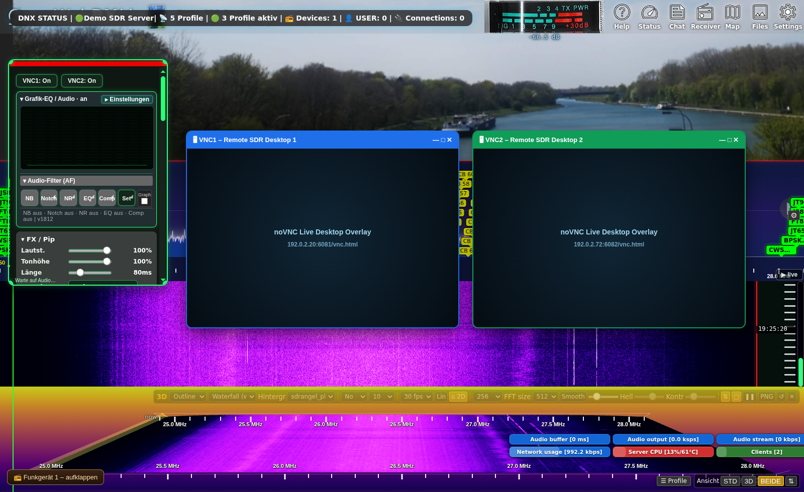
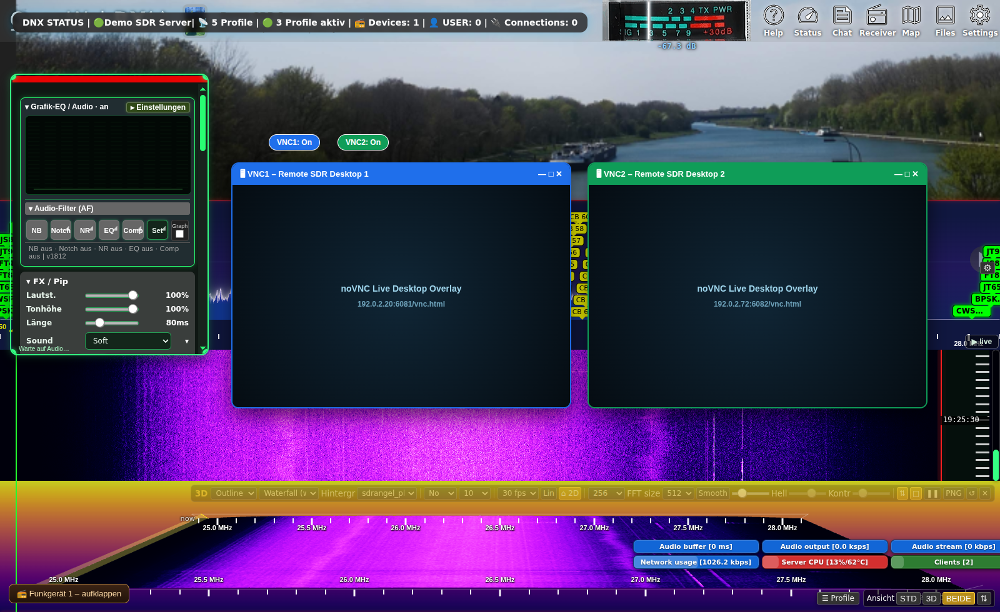

# DNX OWRX VNC1/VNC2 (`v1.0.1`)

<!-- DNX-DISCLAIMER-START -->
> **Wichtiger Hinweis / Vollständige Distanzierung (Hobby-Mod-Mode)**
>
> - **Vollständige Distanzierung:** Ich distanziere mich in jeder Hinsicht vollständig vom Projekt **OpenWebRX / OpenWebRX+** sowie dessen Entwicklern und Betreibern. Es besteht keinerlei Verbindung, Zusammenarbeit, Prüfung, Befürwortung oder Partnerschaft.
> - **Keine öffentlichen/offiziellen OpenWebRX-Plugins (nur Mod-Mode):** Bei diesem Projekt handelt es sich ausdrücklich **nicht** um ein öffentliches oder offizielles Plugin von OpenWebRX, sondern ausschließlich um einen privaten, inoffiziellen **Mod-Mode** (Eigenmodifikation).
> - **Warum bewusst kein reines Browser-JavaScript (Mod-Mode-Architektur):** Viele Funktionen (z. B. serverseitige Speicherung, Konten-/Rollenverwaltung, Profil-Synchronisation, VNC-/websockify-Brücken, geschützte Schnittstellen, Docker-/Systemintegration und stabile UI-Anpassungen) lassen sich sauber und sicher nicht allein über simples Client-JavaScript umsetzen, ohne den OpenWebRX-Kern umzubauen oder Browsergrenzen zu umgehen. Deshalb setzt dieses Projekt bewusst auf getrennte Begleitmodule, Shell-Installer und Dienste im **Mod-Mode** statt alles künstlich in reines JavaScript zu pressen.
> - **Kein öffentlicher Support & keine Haftung:** Es gibt **keinen öffentlichen Support**, keine Garantie und keine Haftung. Nutzung, Installation und Anpassung erfolgen vollständig auf eigene Gefahr (immer vorher Backups anlegen und zunächst im eigenen Testsystem prüfen).
> - **Reines Hobbyprojekt – frei nutzbar, änderbar & verbreitbar:** Dieses Projekt entsteht ausschließlich aus reinem Hobby und Interesse am gemeinsamen Funk-/SDR-Hobby. Es steht ausdrücklich frei zur Verfügung und darf frei genutzt, weiterverbreitet, verändert und verbessert werden.
<!-- DNX-DISCLAIMER-END -->

> **Important Notice / Full Disassociation (Hobby Mod-Mode Only)**
>
> - **Full Disassociation:** I completely disassociate myself from **OpenWebRX / OpenWebRX+** and its developers/maintainers. There is no affiliation, endorsement, review, or partnership of any kind.
> - **No Official/Public OpenWebRX Plugins (Mod-Mode Only):** These files are **not** official or public OpenWebRX plugins, but purely unofficial hobby modifications (*mod-mode*).
> - **Why Not Everything in Pure Browser JavaScript:** Many features (server-side persistence, account/role management, profile syncing, VNC/websockify bridges, protected endpoints, and Docker/host integration) cannot be implemented cleanly or reliably in client-side JavaScript alone without modifying the OpenWebRX core or hitting browser/security limits. That is why this project intentionally uses separate companion scripts, services, and *mod-mode* hooks rather than forcing everything into pure JS.
> - **No Public Support & No Warranty:** There is **no public support**, no warranty, and no liability. Use entirely at your own risk (always create backups and verify on a test system first).
> - **Pure Hobby Project — Free to Use, Modify & Redistribute:** Created solely out of personal hobby interest in the radio/SDR hobby; freely available to use, share, modify, and improve.

<!-- DNX-PREVIEW-START -->
## Live-Vorschau & Galerie / Live Preview (`DNX OWRX VNC1/VNC2`)



| Ansicht / View | Beschreibung / Description | Screenshot |
|---|---|---|
| **Dual noVNC Live-Overlay** | Beide VNC-Ansichten (`VNC1` & `VNC2`) nebeneinander über OpenWebRX+ inklusive Status-Buttons (`VNC1: On`, `VNC2: On`) |  |
| **Frei verschobene VNC-Buttons** | Button-Positionen (`dnx.vnc.btn.pos.v1`) per Ziehen frei auf dem Bildschirm platziert (Reset per Doppelklick) |  |
<!-- DNX-PREVIEW-END -->

All-in-One Dual-noVNC-Overlay und optionaler websockify-Bridge-Dienst (`v1.0.1`) für OpenWebRX+.

All-in-One Dual-noVNC desktop overlay (`VNC1` & `VNC2`) and optional websockify systemd bridge installer (`v1.0.1`) for OpenWebRX+.

## Neu in v1.0.1 / What's New

- **Persistente Button-Position & Doppelklick-Reset (`dnx.vnc.btn.pos.v1`):** `VNC1`- und `VNC2`-Buttons lassen sich frei über die Oberfläche verschieben, speichern ihre Koordinaten im Browser und springen per Doppelklick zurück in die Ausgangsposition.
- **Bereinigte Standard-Konfiguration:** Beispielziele nutzen neutralisierte RFC-5737-Dokumentationsadressen (`192.0.2.20`, `192.0.2.72`) statt realer LAN-IPs.
- **Zwei Modi (`frontend` & `full`):** Nur UI-Overlay auf vorhandene Ports `6082`/`6083` oder inklusive verwaltetem `systemd`-Bridge-Dienst.

## Funktionen / Features

- VNC1 und VNC2 einzeln an/aus (`VNC1: On/Off`, `VNC2: On/Off`), nebeneinander oder als zentrierte Großansicht
- Echte `iframe`-Neuverbindung beim Wiedereinschalten & automatischer noVNC-Reconnect
- Vollbild-Links, Qualitäts-/Kompressionsprofile & lokaler Browser-Speicher
- Status, Backup, Update, Restore & Uninstall direkt über `DNX-VNC1-VNC2-All-in-One.sh`

## Installation & Bedienung / Usage

```bash
chmod +x DNX-VNC1-VNC2-All-in-One.sh
# Nur OpenWebRX-Frontend (vorhandene noVNC-Ports):
sudo ./DNX-VNC1-VNC2-All-in-One.sh install frontend
# Komplett mit websockify-Brücken:
sudo ./DNX-VNC1-VNC2-All-in-One.sh install full
# Status / Update / Entfernen:
./DNX-VNC1-VNC2-All-in-One.sh status
sudo ./DNX-VNC1-VNC2-All-in-One.sh uninstall
```

